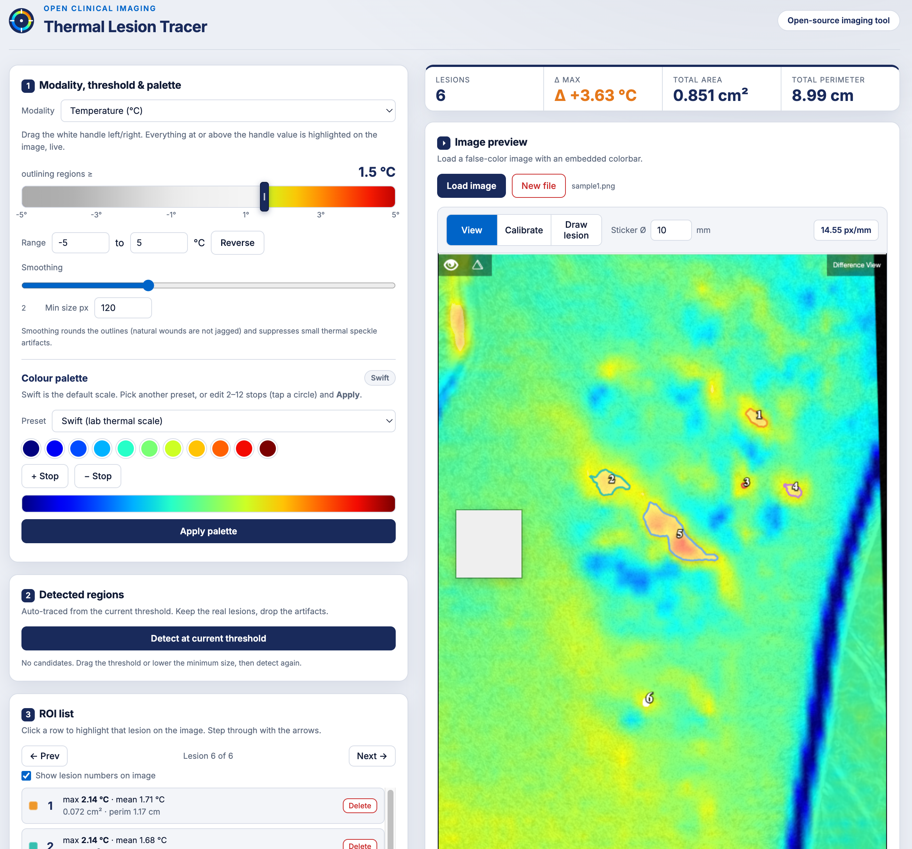

# Thermal Lesion Tracer

Co-developed by **Atif Cader** and **Tahirih Nasseri** (see [Authors](#authors)).

A single-file browser tool for outlining and measuring regions in false-colour thermal images. You load a screenshot from a thermal camera, set a threshold on the temperature scale, and the app finds the regions above that threshold, traces their outlines, measures them, and exports the results as CSV, a labelled PNG, or ImageJ `.roi` files.

Built for an axillary thermography workflow (hidradenitis lesions imaged with a lab thermal scale), but the modality, palette, and value range are all configurable, so it also handles bioluminescence, fluorescence, perfusion, pH, and oxygenation images.

**[Live demo](https://acader05.github.io/thermal-lesion-tracer/)** (see Deployment below)

---

## Why we built it

A lot of how dermatology grades inflammatory skin disease still comes down to a clinician looking at the skin and making a judgement. Scores built on redness, swelling, and lesion counts vary between assessors, and redness in particular is harder to see and grade on darker skin. Patients with skin of colour are already underrepresented in dermatology research, and assessment that depends on visible colour doesn't help.

Infrared thermography measures heat instead of colour. Inflamed tissue runs warmer, and a thermal camera picks that up whether or not the redness is easy to see. We think that makes it a promising route toward assessment that is more objective, more consistent between assessors, and fairer across skin tones. It's still early, and the evidence in conditions like hidradenitis suppurativa (HS) is thin. Part of building that evidence is having a way to turn a thermal image into numbers that can be compared across visits, patients, and studies. That's what this tool is for.

## How we built it

Atif wrote the code. Tahirih was the dermatology expert he went back to throughout development. She explained the clinical side of HS and what a lesion measurement needs to capture, checked the app's outlines and readouts against what she knew clinically, troubleshot the results that didn't look right, and supervised the work as it moved from a rough prototype to the version the lab uses for lesion measurement now. The app works the way it does because of that back and forth.

---

## Running it

Download `index.html` and open it in any modern browser. That's the whole install. There is no build step, no server, no npm, and no external libraries. Everything runs client-side, so images never leave the machine they're opened on, which matters when the inputs are patient photos.

## Workflow

The left side of the app is a set of numbered steps in the order you'd work through an image. All steps are shown by default, so you can go back and change anything. Click a step's header to collapse it; a collapsed step shows a one-line summary of its current setting.

The image sits in a fixed-size viewer on the right. **Fit** shows the whole image, **Actual size** shows it at 100%, and the + and − buttons (or Ctrl + scroll) zoom in and out. When zoomed in, drag the image to pan. Zooming in is useful for clicking the sticker edges accurately during calibration.

1. **Load image.** Any PNG or JPEG screenshot with a false-colour scale.
2. **Scale.** Pick the modality, type the minimum and maximum of the image's colourbar (for example -5 to +5 °C), and choose the palette. Temperature (°C) with the "Swift" palette is the default. The palette is the app's link between colour and value, so it has to match the scale baked into the image. If the image's scale runs hot to cold, type the range backwards (for example 5 to -5). Custom palette stops are tucked under "Edit palette stops".
3. **Calibrate (optional).** Click both edges of the sticker in the image to set a pixels-per-mm scale. Without it, areas are reported in pixels only.
4. **Find lesions.** Drag the threshold marker; pixels at or above it light up as you drag. Smoothing and minimum size filter out speckle. Detect lists candidate regions to keep or drop, one at a time or all at once. Or use Draw by hand: click to place outline points, then click the first point again or press Enter to close the shape.
5. **Lesions.** Step through kept lesions, delete any, and set outline colour, width, and fill per lesion or for all of them.
6. **Export.** Shows the totals (lesion count, Δ max or peak, total area, total perimeter) above the export buttons: a CSV of per-lesion measurements plus a summary row, a PNG with the outlines burned in, or ImageJ ROIs (`.roi` for one, `RoiSet.zip` for several).

### Saving settings

Modality, range, threshold, palette (including custom stops), smoothing, minimum size, sticker size, and the lesion-number toggle are remembered in the browser automatically, so they're still there the next time the app opens. "New file" clears the image and lesions but keeps them. To move settings to another computer or share a setup with someone, use **Save to file** to download `tracer_settings.json` and **Load from file** to apply it. **Reset to defaults** goes back to Temperature (°C), Swift, -5 to 5. Calibration isn't saved, since it depends on each photo.

---

## How it works

The core is a six-stage pipeline, marked with numbered comment banners in the source.

### 1. Colour scale to lookup table

The app needs an ordered list of colours running cold to hot. It builds one from the selected palette: `paletteToLut()` takes the palette's hex stops (11 for Swift, one per degree) and linearly interpolates them into a 256-entry LUT.

There is also a `detectColorbar()` / `sampleColorbar()` pair that reads the scale straight out of the image instead. It scans rows in the lower 45% of the picture looking for a strip whose hue genuinely sweeps across the spectrum, using hue spread and the difference between the left and right ends to reject vivid-but-flat bands of actual image content. The strip is then averaged vertically and resampled to 256 colours. It works, but the palette-driven path turned out to be more predictable in practice, so that's what the UI currently uses. The detector is still in the file.

### 2. Temperature map

`buildTempMap()` draws the image to an offscreen canvas, pulls the raw RGBA bytes with `getImageData()`, and for every pixel finds the nearest LUT entry by squared distance in RGB space. The index of that entry maps linearly onto the user's min/max range, giving a `Float32Array` of one value per pixel.

A parallel `Uint8Array` mask marks which pixels are trustworthy. Anything more than 60 units away from every colour on the scale is off-colormap (text overlays, skin outside the thermal region, UI chrome) and gets excluded. The colourbar strip itself is not excluded right now (see Limitations).

Nearest-neighbour search over 256 entries per pixel is brute force, so two things keep it cheap. Results are cached per colour, since a thermal screenshot reuses a limited set of colours. And the matched scale position is stored per pixel separately from the value, so changing the min/max range only rescales the numbers instead of redoing the search. Dragging the threshold never touches this step.

### 3. Live highlight

`buildHighlight()` writes a translucent white wash into a separate offscreen canvas wherever a pixel is valid and at or above the threshold. Because it only reads the cached temperature map, it's fast enough to rerun during a threshold drag. It reuses one pixel buffer and runs at most once per screen frame. The render loop then stacks three layers onto the visible canvas: the image, the highlight, and the vector overlay of outlines and labels.

### 4. Region detection and contour tracing

`detectRegions()` runs four steps:

- Build a binary mask of pixels above threshold.
- Blur it. `gaussianBlurMask()` is a separable running-sum box blur, applied horizontally then vertically, which approximates a gaussian at a fraction of the cost. Re-thresholding the blurred mask at 0.5 removes isolated speckle and closes small gaps.
- Label connected components with an iterative 4-connected flood fill using an explicit stack. Recursion would blow the call stack on a region of any real size.
- Trace each label's boundary with `traceContour()`, a Moore neighbourhood walk that circles the region clockwise, and drop anything below the minimum pixel count.

Contours over 600 points are decimated, then `smoothSpline()` resamples them as a periodic Catmull-Rom spline. The smoothing slider controls how many samples are taken per segment, so the same control governs both blur strength and outline smoothness.

### 5. Measurement

Area comes from the shoelace formula, perimeter from summed segment lengths. Temperature statistics need per-pixel values inside the polygon, so `measureROI()` scans the bounding box and tests each pixel with a ray-casting point-in-polygon check, accumulating min, max, and mean. If a calibration exists, pixel areas are divided by pixels-per-mm squared to give mm² and cm². Each lesion's measurements are stored and only recalculated when the value map or calibration changes, so clicking through lesions or restyling them doesn't redo the pixel scan.

### 6. Export

- **CSV** is assembled as text and handed to a data URI. It's written with a UTF-8 byte order mark so Excel renders °C, cm², and StO₂ instead of mojibake.
- **PNG** redraws the image and all outlines to an offscreen canvas at full resolution, so the export isn't limited by the on-screen preview size.
- **ImageJ ROI** was the interesting one. `makeImageJRoi()` writes ImageJ's undocumented binary `.roi` format by hand into an `ArrayBuffer`: the `Iout` magic bytes, a big-endian 64-byte header holding the polygon type and bounding box, then x and y coordinates as `Int16` offsets from the box origin, then a second header carrying the name. When there's more than one ROI, `makeZip()` builds a valid ZIP archive byte by byte (local file headers, a CRC-32 implemented from the standard table, central directory, end-of-central-directory record) using the STORE method, no compression. That avoids pulling in a zip library for what amounts to a few hundred bytes per file.

### State and UI

All application state lives in one plain object, `S`, holding the image, the LUT, the typed arrays, the accepted ROIs, and the current mode. Every handler mutates `S` and calls a render function; there is no framework and no virtual DOM. Each ROI carries its own stroke colour, stroke width, and fill opacity, so styles can be set per lesion or pushed to all of them at once.

The palette editor includes a small HSV colour picker drawn with canvas gradients, letting any stop in the palette be edited and reapplied, which rebuilds the LUT and the temperature map.

---

## Deployment

The repo is served with GitHub Pages. In the repository, go to Settings, then Pages, and set the source to the `main` branch and the root folder. GitHub then hosts the app at `https://acader05.github.io/thermal-lesion-tracer/`. The file is named `index.html`, so that URL opens it directly. Because the app is one static HTML file with no backend, that's all the deployment it needs.

## Limitations

- The value map is only as good as the palette match. If the image was rendered with a scale the app doesn't have, values will be systematically wrong even though the outlines look reasonable.
- Colours that appear twice on a scale are ambiguous by construction. Nearest-neighbour lookup picks one and cannot know which is right.
- Anti-aliased pixels along colour boundaries land between LUT entries and are either mapped to a neighbour or dropped by the validity mask.
- Measurements are pixel-based. Anything the camera's perspective distorts, the areas inherit.
- The colourbar isn't masked out automatically. If the scale strip is inside the image, its hot end can come up as a detected region. Drop it from the candidate list, or crop the bar out before loading. The file still has a colourbar detector, but it isn't reliable enough across images to switch on by default.

## Tech

Vanilla JavaScript, HTML, and CSS. Canvas 2D, `ImageData`, typed arrays, `ArrayBuffer` and `DataView` for binary output, Blob and data URIs for downloads. No dependencies.

---

## Authors

### Tahirih Nasseri (she/her)

MD candidate at the Temerty Faculty of Medicine, University of Toronto (class of 2027), with a BSc in Psychology and Biology from the University of Victoria. Her research is in AI-assisted and multimodal skin imaging. She has presented imaging work in vitiligo at the AAD Annual Meeting and the Vitiligo International Congress, and in hidradenitis suppurativa at the EHSF 2026 conference. She is first author on a pilot study combining thermography and wound imaging in HS, accepted for presentation at SHSA 2026.

On this project she was the clinical lead: dermatology expertise, troubleshooting, and supervision from the first prototype onward.

[LinkedIn](https://www.linkedin.com/in/tahirih-nasseri-29962a312/)

### Atif Cader

Researcher in dermatology imaging at the University of Toronto, with a Master of Public Health in occupational health and an honours BSc in physiology and pharmacology. His background is in occupational epidemiology and exposure assessment, including work at the Occupational Cancer Research Centre. In dermatology his focus is infrared thermography, including literature reviews on its use in skin disease and HS, and he is a co-author on the HS pilot above.

On this project he designed and wrote the app.

[ORCID](https://orcid.org/0009-0007-5644-825X) · [GitHub](https://github.com/acader05)

## License

MIT
